<div align="center">


[English](README.md) · **فارسی**

</div>

<div dir="rtl" align="right">

# xr PANEL ‏· ‏Cloudflare Workers + D1

نسخه‌ی کلودفلری xr PANEL: یک **Worker**، یک دیتابیس **D1**، **بدون Xray و بدون سرور**. کاربران، حجم، لوکیشن‌ها، اسکنرها، رله‌ها، فرگمنت و رابط شیشه‌ای همه داخل Worker هستند. موتور پروکسی داخلی است: **VLESS و Trojan روی WebSocket داخل خود Worker تمام می‌شوند** و هر پروتکلی را می‌توان به‌جای آن به یک **سرور upstream ریله** کرد.

</div>


<div dir="rtl" align="right">

## تفاوت با نسخه‌ی Flask + Xray

| قبل | حالا |
|---|---|
| Flask و SQLite روی VPS | Worker و **D1** |
| Xray و nginx، فایل کانفیگ، ری‌استارت | **چیزی برای نوشتن یا ری‌استارت نیست**؛ تغییرها فوری اعمال می‌شوند |
| CPU / RAM / دیسک در Home | کاربران، ترافیک، حالت، خروجی‌ها، رله‌ها، فرگمنت |
| API آمار Xray برای ترافیک | Worker هر WebSocket را برای هر کاربر در D1 می‌شمارد |
| خروجی پروکسی با balancer در Xray | Worker از گروه‌های SOCKS5 / SOCKS4 / HTTP(S) شما عبور می‌کند، سریع‌ترین اول |
| thread پس‌زمینه برای Auto location و Recovery | قدم‌های کوچک که خود صفحه پیش می‌برد؛ با کلیک دوباره متوقف می‌شود |
| تست زنده‌ی فرگمنت روی سرور | با مرورگر شما انجام می‌شود (پایین را ببینید) |

بقیه‌ی امکانات همان است: کاربران، کلاینت‌ها و لینک اشتراک، لوکیشن‌ها، اسکنرها (IP، WARP، MASQUE)، رله روی Vercel / Netlify / Railway، پیشرفته (Spoof، F+F، Fragment، ECH، IPv6)، مبدل و تنظیمات با سایت‌های تست چرخشی.

## معماری

</div>


<div dir="rtl" align="right">

کلاینت به `wss://your-domain/ws/<protocol>/<uuid>` وصل می‌شود. Worker کاربر را در D1 پیدا می‌کند (حجم، انقضا، فعال بودن) و بعد یکی از این دو کار را می‌کند:

- **موتور داخلی**: هدر VLESS یا Trojan را می‌خواند، یک سوکت TCP (‏`cloudflare:sockets`) به مقصد باز می‌کند، **مستقیم یا از گروه خروجی کاربر**، و دو طرف را وصل می‌کند و بایت‌ها را می‌شمارد؛ یا
- **ریله به upstream**: اگر در Settings مقدار *Upstream* را بگذارید، هر چهار پروتکل (VLESS، VMess، Trojan، Shadowsocks) بدون تغییر به `wss://<upstream>/ws/<protocol>/<uuid>` فرستاده می‌شوند، با همان شمارش و همان کنترل حجم و انقضا در همین Worker.

</div>


<div dir="rtl" align="right">

| پروتکل | بدون upstream | با upstream |
|---|---|---|
| VLESS | داخلی | ریله |
| Trojan | داخلی | ریله |
| VMess | داخلی (AEAD، alterId صفر: AES-128-GCM / ChaCha20-Poly1305) | ریله |
| Shadowsocks | داخلی (chacha20-ietf-poly1305 و aes-256-gcm، تشخیص خودکار) | ریله |

لینک اشتراک فقط چیزهایی را نشان می‌دهد که در حالت فعلی واقعاً کار می‌کنند.

## استقرار

حساب Cloudflare و Node.js نسخه‌ی ۱۸ به بالا لازم است.

</div>

```bash
npm install
npx wrangler login
npx wrangler d1 create xr-panel          # یک database_id چاپ می‌کند
# آن id را در wrangler.toml بگذارید  ->  database_id = "..."
npx wrangler deploy
```

<div dir="rtl" align="right">

آدرس `https://xr-panel.<your-subdomain>.workers.dev` را باز کنید، با **`admin` / `admin`** وارد شوید و **همان لحظه رمز را عوض کنید** (Settings). جدول‌ها در اولین درخواست خودکار ساخته می‌شوند؛ اگر بخواهید از قبل بسازید `npm run db:init` همان schema را اجرا می‌کند.

بعد در Settings:

1. **Domain** را خالی بگذارید تا از همان آدرسی که باز کرده‌اید استفاده شود، یا دامنه‌ی اختصاصی‌ای که به Worker وصل کرده‌اید را بنویسید.
2. (اختیاری) **Upstream** را بگذارید تا همه‌ی پروتکل‌ها به سرور دیگری ریله شوند.
3. کاربر بسازید و لینک `/sub/<uuid>` هر کدام را بدهید.

برای توسعه: `npx wrangler dev`. تست‌ها: `npm test` (انتهای همین فایل).

## اسکنرها، WARP و MASQUE

</div>


<div dir="rtl" align="right">

اسکنرها داخل **مرورگر شما** اجرا می‌شوند و شبکه‌ی خودتان را می‌سنجند. اسکن MASQUE فقط وقتی شروع می‌شود که یک دستگاه MASQUE ثبت شده باشد؛ هر IP اندپوینت بررسی می‌شود و بعد تک‌تک پورت‌های MASQUE روی آن آزمایش می‌شوند (‏`tcp` = تأییدشده، ‏`udp` = IP زنده است ولی پورت را فقط خود کلاینت می‌تواند ثابت کند). پورت پیش‌فرض اسکنر IP **۲۰۵۳** است.

</div>


<div dir="rtl" align="right">

دستگاه‌ها را **خود Worker** با WebCrypto ثبت می‌کند (‏X25519 برای WireGuard و ECDSA P-256 برای MASQUE)، چون مرورگر نمی‌تواند API ثبت‌نام Cloudflare را صدا بزند (CORS).

## فرگمنت

</div>


<div dir="rtl" align="right">

**Advanced ← Fragment** شبکه‌ی مرورگر شما را می‌سنجد (میانه‌ی RTT، جیتر و درصد موفقیت روی سه **سایت تست** بعدی)، یکی از **fast / mid / slow / none** را انتخاب می‌کند و فرگمنت را در لینک هر کانفیگی که می‌تواند حملش کند می‌نویسد: VLESS و Trojan روی TLS (و Shadowsocks وقتی upstream دارید). لینک VMess و کانفیگ‌های White IP بدون TLS هرگز فرگمنت نمی‌گیرند.

Worker نمی‌تواند handshake‌ی TLS را تکه‌تکه کند (این کار را *برنامه‌ی کلاینت* می‌کند)، پس تست زنده با نسخه‌ی Flask فرق دارد: مرورگر شما به endpoint هر پروتکل روی همین Worker یک WebSocket باز می‌کند. پروتکلی که جواب ندهد **فرگمنت نمی‌گیرد**. پروفایل `fast` همان ماسک ثابت F+F است؛ تأخیرهای `mid` و `slow` تجربی‌اند و بهتر است با کلاینت خودتان امتحانشان کنید.

</div>


<div dir="rtl" align="right">

**Settings ← Test sites**: نه سایت پیش‌فرض، هر تعداد که بخواهید اضافه یا حذف کنید؛ هر سنجش سه‌تای بعدی را برمی‌دارد و همه‌ی سایت‌ها به نوبت استفاده می‌شوند.

## پیشرفته

</div>


<div dir="rtl" align="right">

## لوکیشن‌ها: Auto و Recovery

</div>


<div dir="rtl" align="right">

- **Auto location** لیست‌های رایگان پروکسی را می‌گیرد، پروکسی‌های سالم را نگه می‌دارد، موقعیتشان را پیدا می‌کند و تا **۱۰** لوکیشن اضافه می‌کند، از هر کشور یکی؛ کشورهایی را ترجیح می‌دهد که ندارید و دفعه‌ی قبل هم نگرفتید.
- **Recovery** ایپی و پورت هر کشور فعلی را با یک پروکسی سالم تازه از همان کشور عوض می‌کند؛ اگر پیدا نشود قبلی می‌ماند.
- هر دو با قدم‌های کوچک توسط صفحه پیش می‌روند (حدود دوازده پروکسی در هر درخواست که در سقف ۵۰ subrequest پلن رایگان جا می‌شود). **برای توقف، دکمه‌ی در حال اجرا را دوباره بزنید.** تا پایان کار صفحه را باز نگه دارید.

کاربری که به یک گروه وصل است از پروکسی‌های آن (SOCKS5، SOCKS4، HTTP یا HTTPS) خارج می‌شود، سریع‌ترین اول و در صورت خرابی بعدی.

## رله‌ها

</div>


<div dir="rtl" align="right">

یک forwarder کوچک روی Vercel، Netlify یا Railway می‌سازد که به همین Worker اشاره می‌کند. استقرار یک ماشین حالت کوچک است که polling وضعیت در صفحه آن را جلو می‌برد، پس صفحه‌ی Relays را باز نگه دارید تا *ok* شود. توکن‌ها در D1 می‌مانند و هرگز نمایش داده نمی‌شوند.

## داشبورد و مبدل

</div>



<div dir="rtl" align="right">

## محدودیت‌هایی که باید بدانید

- **قوانین Cloudflare.** اجرای پروکسی/VPN روی Workers ممکن است با شرایط استفاده‌ی Cloudflare تعارض داشته باشد و حساب‌هایی به همین خاطر معلق شده‌اند. با مسئولیت خودتان استفاده کنید و حالت upstream یا دامنه‌ی خودتان را در نظر بگیرید.
- **اتصال مستقیم به IPهای خود Cloudflare ممکن نیست** (قانون پلتفرم برای سوکت‌های Worker). برای چنین مقصدهایی از گروه پروکسی خروجی یا upstream استفاده کنید.
- **UDP نیست** جز DNS (‏VLESS UDP به پورت ۵۳ از طریق DoH پاسخ داده می‌شود).
- **زمان CPU.** پلن رایگان برای هر درخواست ۱۰ میلی‌ثانیه CPU می‌دهد؛ ورود از PBKDF2 (با ۲۰٬۰۰۰ تکرار) استفاده می‌کند و ترافیک سنگین ممکن است به سقف بخورد. برای استفاده‌ی جدی پلن پولی پیشنهاد می‌شود.
- **Auto location** به لیست‌های عمومی پروکسی و سرویس‌های عمومی geo-IP وابسته است؛ پروکسی رایگان ناپایدار است، پس گاهی Recovery بزنید.
- مصرف هر حدود ۵۱۲ کیلوبایت یا ۳۰ ثانیه و هنگام بسته شدن اتصال در D1 نوشته می‌شود، پس قطع ناگهانی ممکن است چند ثانیه از شمارش را از بین ببرد.

## ساختار پروژه

</div>

```
wrangler.toml     Worker، فایل‌های استاتیک، اتصال D1
schema.sql        اختیاری: ساخت جدول‌ها از قبل
src/index.js      روتر و handlerها (ورود، کاربران، لوکیشن، اسکنر، رله، ...)
src/relay.js      موتور VLESS / Trojan، ریله به upstream، شمارنده‌ی مصرف، SHA-224
src/proxy.js      کلاینت SOCKS5 / SOCKS4 / HTTP(S) روی سوکت Worker
src/loc.js        گروه‌ها، geo، قدم‌های Auto location و Recovery
src/links.js      لینک اشتراک، Spoof / F+F / Fragment / ECH / IPv6
src/warp.js       ثبت WARP و MASQUE (WebCrypto)
src/relays.js     استقرار روی Vercel / Netlify / Railway
src/ui.js         صفحه‌ها؛  src/db.js، auth.js، html.js  ابزارها
public/static/    css و اسکریپت‌های مرورگر (اسکنرها، مبدل، فرگمنت، ...)
test/             مجموعه‌ی تست (Node و شبیه‌ساز D1 روی node:sqlite)
```

<div dir="rtl" align="right">

## تست

</div>

```bash
npm test      # Node 22 به بالا: ۱۹ تست
```

<div dir="rtl" align="right">

این مجموعه کد واقعی Worker را روی شبیه‌ساز D1 در حافظه و سوکت‌های TCP واقعی (سرورهای echo و پروکسی SOCKS5، SOCKS4 و HTTP) اجرا می‌کند: عبور VLESS و Trojan از Worker، گروه‌های خروجی، ریله به upstream، حجم، لینک‌ها در هر حالت، پروفایل‌های فرگمنت، Auto location و Recovery، ساخت کلید WARP/MASQUE، ماشین حالت استقرار رله و بیشتر. این تست‌ها **داخل runtime خود Cloudflare اجرا نمی‌شوند**، پس بعد از اولین استقرار یک smoke test بزنید.

</div>


## هر چهار پروتکل داخلی‌اند؛ وب‌پروکسی تلگرام برای هر کاربر جداست

- **VLESS، VMess، Shadowsocks و Trojan** همگی داخل Worker روی WebSocket (`/ws/<protocol>/<uuid>`) پایان می‌یابند. پورتی که در همه‌ی کانفیگ‌ها نوشته می‌شود **Settings ← Port** است (Cloudflare فقط ۴۴۳، ۸۴۴۳، ۲۰۵۳، ۲۰۸۳، ۲۰۸۷ و ۲۰۹۶ را با TLS سرو می‌کند و Worker نمی‌تواند پورت اختصاصی باز کند). *Upstream* اکنون اختیاری است.
- **محدودیت‌ها زنده‌اند.** هر بایت شمرده می‌شود؛ نشست در حال اجرا همان لحظه‌ای که حجم کاربر تمام شود، انقضا برسد یا حساب غیرفعال شود قطع می‌شود.
- **وب‌پروکسی تلگرام** دیگر تنظیم سراسری نیست. هر کاربر هنگام ساخته‌شدن یک secret مخصوص خودش می‌گیرد (کاربران قدیمی در اولین درخواست بعد از به‌روزرسانی)؛ لینک آن در صفحه‌ی subscription کاربر و در *Users ← Telegram proxy* است. *Users ← Edit ← New Telegram secret* لینک قبلی و همه‌ی توکن‌های آن را باطل می‌کند. حجم و انقضای کاربر برای وب‌پروکسی هم، در هر دو جهت، اعمال می‌شود.
- پوشش داده نشده: وب‌پروکسی از گروه خروجی کاربر استفاده نمی‌کند (مستقیم به تلگرام وصل می‌شود)، UDP در Shadowsocks حمل نمی‌شود، و VMess فقط کلاینت‌های `alterId 0` را می‌پذیرد (همه‌ی کلاینت‌های امروزی).
