<div align="center">


**English** · [فارسی](README.fa.md)

</div>

# xr PANEL · Cloudflare Workers + D1

The xr PANEL rebuilt for Cloudflare: one **Worker**, one **D1** database, **no Xray and no server to run**. Users, quotas, exit locations, scanners, relays, fragment and the liquid-glass UI all live in the Worker. The proxy engine is built in: **VLESS and Trojan over WebSocket are terminated inside the Worker**, and any protocol can instead be **relayed** to an upstream server.


## What changed compared with the Flask + Xray version

| Before | Now |
|---|---|
| Flask + SQLite on a VPS | Worker + **D1** |
| Xray + nginx, config files, restarts | **Nothing to write or restart**: changes apply instantly |
| CPU / RAM / disk on Home | Users, traffic, mode, exits, relays, fragment |
| Xray stats API for traffic | The Worker meters every WebSocket per user in D1 |
| Exit proxies through Xray balancers | The Worker dials through your SOCKS5 / SOCKS4 / HTTP(S) proxy groups, fastest first |
| Background threads for Auto location / Recovery | Small steps driven by the page (a Worker request is short); stop with a second click |
| Fragment live check done by the server | Done by your browser (WebSocket to each endpoint), see below |

Everything else is the same: users, clients and subscription links, locations, scanners (IP, WARP, MASQUE), relays on Vercel / Netlify / Railway, Advanced (Spoof, F+F, Fragment, ECH, IPv6), Convert and Settings with the rotating test sites.

## Architecture


A client opens `wss://your-domain/ws/<protocol>/<uuid>`. The Worker looks the user up in D1 (quota, expiry, on/off), then either

- **built-in engine**: parses the VLESS or Trojan header, opens a TCP socket (`cloudflare:sockets`) to the target, **directly or through the user's exit group**, and pipes both ways while counting bytes; or
- **upstream relay**: when *Upstream* is set in Settings, every protocol (VLESS, VMess, Trojan, Shadowsocks) is forwarded unchanged to `wss://<upstream>/ws/<protocol>/<uuid>`, still metered and still enforced here.


| Protocol | Without upstream | With upstream |
|---|---|---|
| VLESS | built in | relayed |
| Trojan | built in | relayed |
| VMess | built in (AEAD, alterId 0: AES-128-GCM / ChaCha20-Poly1305) | relayed |
| Shadowsocks | built in (chacha20-ietf-poly1305 and aes-256-gcm, auto-detected) | relayed |

Subscription links only list what actually works in the current mode.

## Deploy

You need a Cloudflare account and Node.js 18+.

```bash
npm install
npx wrangler login
npx wrangler d1 create xr-panel          # prints a database_id
# paste that id into wrangler.toml  ->  database_id = "..."
npx wrangler deploy
```

Open `https://xr-panel.<your-subdomain>.workers.dev`, sign in with **`admin` / `admin`** and **change the password straight away** (Settings). The tables are created automatically on the first request; `npm run db:init` runs the same schema up front if you prefer.

Then, in Settings:

1. Leave **Domain** empty to use the address you opened, or enter a custom domain you attached to the Worker.
2. (Optional) set **Upstream** to relay every protocol to another server.
3. Create users and hand out their `/sub/<uuid>` links.

For development: `npx wrangler dev`. Tests: `npm test` (see the end of this file).

## Scanners, WARP and MASQUE


The scanners run in **your browser**, so they measure your connection. The MASQUE scan only starts when a MASQUE device is registered; each endpoint IP is checked and then every MASQUE port is tested on it (`tcp` = verified, `udp` = IP alive, port proven only by the client app). The default port of the IP scanner is **2053**.


Devices are registered **by the Worker** with WebCrypto (X25519 for WireGuard, ECDSA P-256 for MASQUE), because browsers cannot call Cloudflare's registration API (no CORS).

## Fragment


**Advanced → Fragment** measures your browser's connection (median RTT, jitter, success rate on the next three **test sites**), picks **fast / mid / slow / none** and writes the fragment into every link that can carry it: VLESS and Trojan on TLS (and Shadowsocks when an upstream is set). VMess links and plain non-TLS White IP configs never get one.

A Worker cannot cut a TLS handshake into pieces (the *client app* does that), so the live check is different from the Flask version: your browser opens a WebSocket to each protocol's endpoint on this Worker. A protocol that does not answer gets **no** fragment. The `fast` profile equals the fixed F+F mask; `mid` and `slow` delays are heuristics, so try them with your own client.


**Settings → Test sites**: nine defaults, add or remove freely; every measurement takes the next three, so all sites are used in turn.

## Advanced


## Locations: Auto and Recovery


- **Auto location** downloads free proxy lists, keeps working proxies, geo-locates them and adds up to **10** locations, one per country, preferring countries you do not have and did not get last run.
- **Recovery** swaps the IP and port of every current country for a new working proxy from the same country; when none is found the old one stays.
- Both are driven in small steps by the page (about a dozen proxies per request, which fits the free plan's 50 subrequests). **Click the running button again to stop.** Keep the page open while it runs.

A user assigned to a group exits through its proxies (SOCKS5, SOCKS4, HTTP or HTTPS), fastest first, falling back to the next one.

## Relays


Deploys a tiny forwarder on Vercel, Netlify or Railway that points at this Worker. A deploy is a small state machine advanced by the page's status polling, so keep the Relays page open until it shows *ok*. Tokens live in D1 and are never rendered.

## Dashboard and Convert



## Limits you should know

- **Cloudflare's terms.** Running a proxy/VPN on Workers can go against Cloudflare's terms of service and accounts have been suspended for it. Use it at your own risk and consider the upstream mode, or your own domain.
- **Direct connections cannot reach Cloudflare-owned IPs** (a platform rule for Worker sockets). For such targets use an exit proxy group or an upstream.
- **No UDP** except DNS (VLESS UDP to port 53 is answered over DoH).
- **CPU time.** The free plan gives 10 ms of CPU per request; login uses PBKDF2 (20 000 iterations) and heavy traffic may hit limits. The paid plan is recommended for real use.
- **Auto location** depends on public proxy lists and public geo-IP services; free proxies are unreliable, so run Recovery now and then.
- Usage is written to D1 every ~512 KB or 30 s and when a connection closes, so a hard crash can lose a few seconds of counting.

## Project layout

```
wrangler.toml     Worker, static assets, D1 binding
schema.sql        optional: create the tables up front
src/index.js      router and handlers (login, users, locations, scanners, relays, ...)
src/relay.js      VLESS / Trojan engine, upstream relay, live usage meter (volume + expiry)
src/vmess.js      native VMess (AEAD header, SHAKE128 chunk masking, AES-GCM / ChaCha20)
src/shadowsocks.js native Shadowsocks AEAD
src/crypto.js     MD5, SHA-2, SHAKE128, ChaCha20-Poly1305 and WebCrypto helpers (no dependencies)
src/proxy.js      SOCKS5 / SOCKS4 / HTTP(S) client over Worker sockets
src/loc.js        groups, geo lookup, Auto location and Recovery steps
src/links.js      subscription links, Spoof / F+F / Fragment / ECH / IPv6
src/warp.js       WARP and MASQUE registration (WebCrypto)
src/relays.js     Vercel / Netlify / Railway deployers
src/ui.js         pages;  src/db.js, auth.js, html.js  helpers
public/static/    css and browser scripts (scanners, convert, fragment, ...)
test/             test suite (Node + a D1 emulation on node:sqlite)
```

## Tests

```bash
npm test      # Node 22+: 19 tests
```

The suite runs the real Worker code against an in-memory D1 emulation and real TCP sockets (echo, SOCKS5, SOCKS4 and HTTP proxy servers): VLESS and Trojan echo through the Worker, exit groups, upstream relay, quotas, links for every mode, fragment tiers, Auto location and Recovery, WARP/MASQUE key generation, relay deploy state machines and more. It does **not** run inside Cloudflare's runtime, so do a smoke test after your first deploy.


## All four protocols are built in; the Telegram Web Proxy is per user

- **VLESS, VMess, Shadowsocks and Trojan** are all terminated inside the Worker over WebSocket (`/ws/<protocol>/<uuid>`). The port written into every config is **Settings → Port** (Cloudflare only serves 443, 8443, 2053, 2083, 2087 and 2096 over TLS; a Worker cannot open a port of its own). *Upstream* is now optional.
- **Limits are live.** Every byte is metered; a running session is cut the moment the user's volume is used up (checked locally, exact for one session) or the expiry passes (a timer re-reads the account), or the account is disabled.
- **Telegram Web Proxy** is no longer a global setting. Each user gets a secret when created (existing users get one on the first request after the update); the link is on the user's subscription page and in *Users → Telegram proxy*. *Users → Edit → New Telegram secret* revokes the old link and every token signed with it. Volume and expiry of the user apply to it too, in both directions.
- Not covered: the Web Proxy does not use the user's exit group (it connects to Telegram directly), Shadowsocks UDP is not carried, and VMess needs `alterId 0` clients (all current ones).
